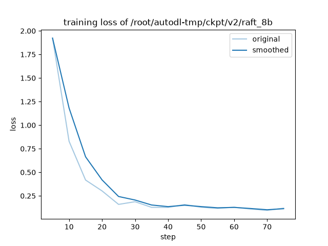

# doc-distill：把大模型的"法规问答"能力蒸馏到可离线运行的小模型

用 DeepSeek 当老师，在 7 份公开的仓储安全法规上自动生成训练数据，按 **RAFT**（Retrieval-Augmented Fine-Tuning）方法给 Qwen3-8B / 1.7B 做 LoRA 微调。目标是让小模型学会三件事：**在混着干扰段的资料里找到正确依据、逐字引用原文、资料里没有答案时拒绝回答**。训练好的模型用 vLLM 部署，或量化后放进 Ollama 在笔记本上离线运行，最后接回我自己的树索引检索系统 tree-RAG（思路参考 [PageIndex](https://github.com/VectifyAI/PageIndex)）做端到端评测。

全部训练在一张按量租用的 RTX 4090（48GB，¥3.03/小时，三次开机合计约 4 小时）上完成；出题、裁判和老师作答共调用 DeepSeek API 约 ¥3.3。

## 主要结果

**RAFT 测试集**：71 题，其中 55 题资料中有答案、16 题应当拒答。测试题所在的文档块不出现在训练集里。

| 模型 | 答案正确率 | 引用正确率 | 拒答率 | 单条延迟 |
|---|---:|---:|---:|---:|
| Qwen3-8B 原版 | 91% | 55% | 38% | 1.6 s |
| Qwen3-8B + 普通 SFT（对照组） | 88% | 75% | **6%** | 1.6 s |
| **Qwen3-8B + RAFT** | 92% | **87%** | **94%** | 1.2 s |
| Qwen3-1.7B 原版 | 80% | 5% | 25% | 0.7 s |
| **Qwen3-1.7B + RAFT** | 79% | 76% | 81% | 0.3 s |
| 1.7B + RAFT，Q4 量化，笔记本 CPU（Ollama） | 76% | 65% | 69% | 25 s |
| DeepSeek（老师） | 99% | 84% | 88% | 1.3 s |

**端到端**：tree-RAG 真实检索 + 只取前 4 段资料作答，71 题。

| 回答模型 | 原顺序 | BM25 重排 | bge-reranker 重排 |
|---|---:|---:|---:|
| 标准答案原文进入前 4 段的比例 | 83% | 92% | 94% |
| DeepSeek | 85% | ~90% | **~93%** |
| 本地 1.7B（Q4，离线） | 73% | 76% | 77% |

作为参照：DeepSeek 读取全部 12.6 段命中资料时为 92%。完整数据、实验设置和局限见 [results/REPORT.md](results/REPORT.md)。

## 五个发现

1. **拒答样本是 RAFT 不可省略的部分。** 只用"每题都有答案"的数据做普通 SFT，模型的拒答率从 38% 跌到 0%～6%：遇到资料里没有答案的问题，它会随便引用一段不相干的条款硬答。加入约 20% 的拒答样本后，8B 的拒答率达到 94%，超过老师（88%）。
2. **构造拒答样本时有标签泄漏。** 最初的拒答样本从同一份文档里挑干扰段，但法规相邻条款经常能回答同一个问题，导致"应拒答"的标签是错的。改为只从其他文档取干扰段，并让 LLM 二次核查，剔除了 12 条错标样本。
3. **训练和推理的对话模板必须逐 token 一致，这个问题在三个环节各出现了一次。**
   - LLaMA-Factory 的 `qwen3_nothink` 模板缺少 vLLM 在 `enable_thinking=False` 时插入的空 `<think>` 块，导致 v1 模型常常漏写开头的「依据」。`scripts/check_template.py` 可以逐 token 证明这一点。改用 `qwen3` 模板加 `enable_thinking: false` 后，格式遵循率从 73%/86% 提高到 100%，拒答率从 69% 提高到 94%。
   - Ollama 会优先使用 GGUF 文件自带的 Jinja 模板、忽略 Modelfile 里写的 TEMPLATE，并且默认开启思考模式，结果 16/71 题的回答全进了 thinking 字段，正文为空。需要在原生接口传 `think: false`，或在 OpenAI 兼容接口传 `reasoning_effort: "none"`。
4. **端到端的瓶颈在排序，而不在回答模型。** 标准答案原文出现在全部命中段里的比例是 94%，但只有 83% 排进了前 4 段。只要答案在前 4 段，DeepSeek 的正确率就有 98%。重排后，前 4 段命中率提高到 92%（BM25，几乎零成本）和 94%（bge-reranker）。DeepSeek 只读 4 段，就追平了读全部 12.6 段的效果。
5. **学生在引用上超过了老师。** 8B + RAFT 的引用正确率是 87%，DeepSeek 是 84%：老师经常改写原文，学生学到的是逐字引用。

## 流水线

```
公开法规 7 份 ──extract/chunk──▶ 166 块
   │
   ▼ gen_qa.py：DeepSeek 每块出 3 题（事实型 / 条件判断型 / 情景应用型），引用必须能逐字对上原文
498 题 ──build_raft.py──▶ RAFT 训练集 414 / 测试集 71（按块划分）
   │  每题 4 段资料：80% 含正确原文 + 2 段 BM25 难干扰 + 1 段随机干扰；20% 全是干扰 → 拒答
   ▼ LLaMA-Factory LoRA（rank 16，3 轮）
Qwen3-8B / 1.7B 适配器 ──▶ vLLM 多 LoRA 评测（eval_gen.py）
   │
   ├─▶ merge_lora.py → llama.cpp GGUF → Q4_K_M → Ollama（笔记本离线）
   └─▶ tree-RAG 检索 → rerank.py → 前 4 段 → 回答（e2e_eval.py）
```



## 复现

```bash
# 1. 资料与训练数据（本地，需要 DEEPSEEK_API_KEY）
python scripts/fetch_corpus.py && python scripts/extract.py && python scripts/chunk.py
python scripts/gen_qa.py --sample 3     # 先抽样看出题质量
python scripts/gen_qa.py
python scripts/build_raft.py

# 2. 训练与评测（GPU 服务器，LLaMA-Factory 0.9.5 + vLLM 各一个虚拟环境）
python scripts/check_template.py        # 训练与推理的提示词必须逐 token 一致
llamafactory-cli train train/v2/raft_8b.yaml
python scripts/eval_gen.py 8b           # 环境变量 CKPT_DIR / PRED_DIR / SKIP_BASE 见脚本

# 3. 打分（本地，DeepSeek 当裁判）
python scripts/teacher_preds.py && python scripts/score.py

# 4. 本地离线部署
python scripts/merge_lora.py <Qwen3-1.7B 路径> <适配器路径> models/raft-1.7b-merged
python llama.cpp/convert_hf_to_gguf.py models/raft-1.7b-merged --outtype f16 --outfile models/raft-1.7b-f16.gguf
llama-quantize models/raft-1.7b-f16.gguf models/raft-1.7b-Q4_K_M.gguf Q4_K_M
ollama create raft-1.7b -f deploy/Modelfile.raft-1.7b
python scripts/eval_ollama.py raft-1.7b raft_1.7b_v2_q4_ollama

# 5. 端到端（需要 tree-RAG 的 ANSWER_* / RERANK 配置）
python scripts/rerank.py
python scripts/e2e_eval.py --mode tree+bge
```

## 目录

```
scripts/   数据（fetch/extract/chunk/gen_qa/build_raft）· 训练评测（check_template/eval_gen/teacher_preds/score）
           · 部署（merge_lora/eval_ollama）· 端到端（rerank/e2e_eval）
train/     LLaMA-Factory 配置；v2/ 是修复模板后的版本；pipeline*.sh 是服务器上的一键流水线
data/      出题结果 qa_raw.jsonl、RAFT 训练集和测试集、对照组训练集
preds/     每个模型对测试集的回答；results/  REPORT、评分、训练曲线、端到端结果
deploy/    Ollama Modelfile
```

## 局限

- 测试集较小（55 + 16 题），每题约占 1.4～6 个百分点；只跑了一个随机种子；裁判和出题老师是同一个模型，重复打分有 ±1～2 题的波动。
- 端到端评测的 71 题在资料库中都有答案，没有测拒答；检索部分仍然调用 DeepSeek，只有"回答"这一步是离线的。
- 资料只有 7 份法规，领域很窄，结论不一定能推广到其他领域。

## 资料来源与许可

资料均为政府公开发布的法律、规章和规范性文件（来源见 `scripts/fetch_corpus.py`），依据《著作权法》第五条不适用著作权保护；仓库内不包含原始文件。`data/` 中的问答由 DeepSeek 基于这些文件生成。代码使用 MIT 许可。
